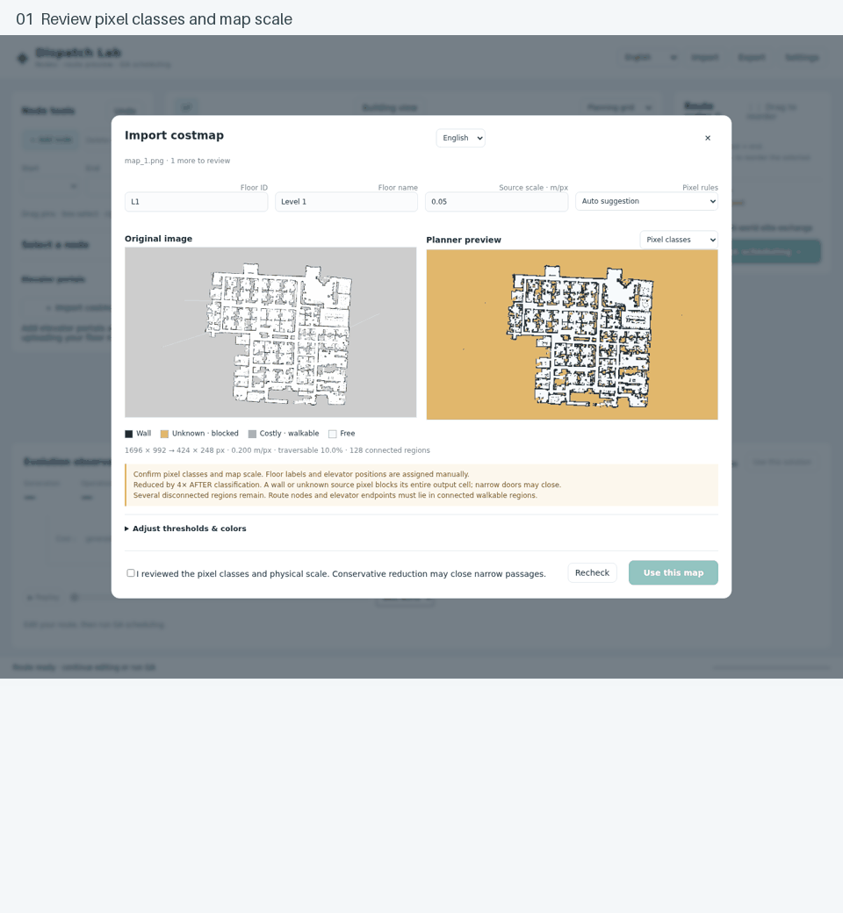

# Dispatch Lab

Plan robot deliveries across multiple floors. Place and reorder nodes, preview obstacle-aware routes instantly, and optimize deliveries across floors.



*Screenshot walkthrough: review pixels → assign floors → pair elevators → plan routes.*

## Features

- **Multi-floor routing** with reviewed image imports, paired elevator endpoints, and preflight validation.
- **Direct map editing** with draggable pins, box selection, right-click actions, and reorderable stops.
- **A* + genetic optimization** for routes and delivery sequences.
- **Replay and inspection** with W/D/T matrices and scene import/export.
- **English / 繁體中文** throughout the editor; English on first launch.

## Quick start

```bash
git clone https://github.com/a0665x/Genetic_Algorithm_TSP.git
cd Genetic_Algorithm_TSP
conda env create -f environment.yml
conda activate dispatch-lab
python app.py
```

Open **http://127.0.0.1:8000**. No GPU or frontend build is required.

Using an existing checkout? Run `git pull origin main` before starting the app. For a pip-based installation, see the [setup guide](docs/guide.md#installation).

## Try it

1. Add or drag nodes. The first node is the green start; the last is the red finish.
2. Drag the right-hand list to reorder stops. A* previews the route before optimization.
3. Run **GA**, toggle **SAW**, and replay elite routes in the evolution observatory.

In **Settings → Floors & elevators**, import your maps or a bundled reference scan, assign floor labels and scale, review pixel classes, and place both ends of each elevator. Incomplete links are shown as half-links and block planning until repaired or disabled.

Advanced controls and formulas stay collapsed until you need them.

## Documentation

[Map import](docs/semantic_maps.md) · [Usage and configuration](docs/guide.md) · [Mathematical model](docs/math_model.md) · [Developer checks](docs/guide.md#development)

Local, single-robot simulation with example maps—not a hardware controller. Keep the server on localhost; do not expose it directly to the public internet.

[Apache 2.0 license](LICENSE)
