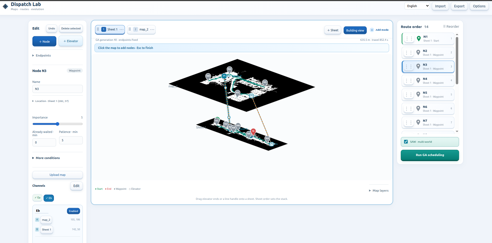
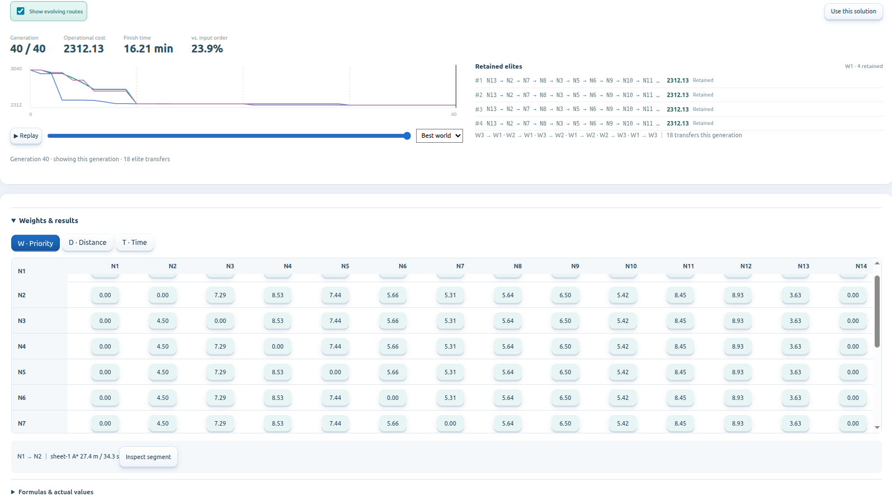

# Dispatch Lab

Drop in a map, drag your stops, and plan a delivery route. Add more sheets and connect elevator entrances when you need them.



*Multi-floor editing, draggable elevator channels, delivery nodes and collision-free routes.*



*GA evolution, Sower elite exchange, operational metrics and inspectable result matrices.*

<details>
<summary>Watch the complete UI walkthrough</summary>


</details>

*Actual UI walkthrough: one sheet → connect maps → rearrange layers → explore evolution.*

## Features

- **Sheet-first editing** — upload maps, drag tabs to stack them, name floors later.
- **Direct interaction** — draggable pins, route blocks, right-click actions and undo.
- **Elevator channels** — connect two entrances; drag endpoints or line handles in the building view.
- **A* + GA scheduling** — instant ordered-route preview, SAW worlds, elite replay and optional calculation details.
- **English / 繁體中文** — switch without changing your scene or results.

## Quick start with Docker

```bash
git clone https://github.com/a0665x/Genetic_Algorithm_TSP.git
cd Genetic_Algorithm_TSP
./run.sh
```

Open **http://127.0.0.1:8000**. The container is bound to localhost, runs as a non-root user, and does not need a GPU or frontend build.

Common lifecycle commands:

```bash
./run.sh --rebuild   # clean image rebuild and container recreation
./run.sh stop        # stop without removing the container
./run.sh restart     # restart the application
./run.sh down_up     # remove and recreate the stack
./run.sh status      # show status and health
./run.sh logs        # follow logs
./run.sh down        # stop and remove the stack
```

Set another host port with `PORT=8080 ./run.sh`. Run `./run.sh help` for the full command list.

## Run directly with Python

```bash
conda env create -f environment.yml
conda activate dispatch-lab
python app.py
```

The pip/venv alternative is in the [setup guide](docs/guide.md#installation).

To refresh an existing checkout before starting: `git pull --ff-only origin main`.

## Try it

1. Choose **Upload map**, check the preview, and press **Use this map**. Add stops directly on the sheet.
2. Add another **Sheet** when needed. **+ Elevator** connects two map positions without adding delivery stops.
3. Drag stops or sheet tabs, then run **GA scheduling** and explore the evolution observatory.

Floor labels, image adjustments and algorithm settings remain optional. An assumed map scale is shown until you supply a real one. Incomplete channels remain visible and block planning.

## Documentation

[Maps](docs/semantic_maps.md) · [Usage](docs/guide.md) · [Mathematics](docs/math_model.md) · [Developer checks](docs/guide.md#development)

## Notebooks and historical prototypes

Start Jupyter with `jupyter lab notebook` after installing `requirements-notebook.txt`. The concise [`dispatch_lab_demo.ipynb`](notebook/dispatch_lab_demo.ipynb) runs the current A* + GA pipeline end to end; the other notebooks provide a deeper tutorial and preserve earlier experiments.

Historical standalone implementations live under `legacy/ga_apf_routing` and `legacy/weight_table_routing`. They are retained for comparison and are not used by the web application or Docker image.

Local, single-robot simulation—not a hardware controller. Keep the server on localhost.

[Apache 2.0 license](LICENSE)
